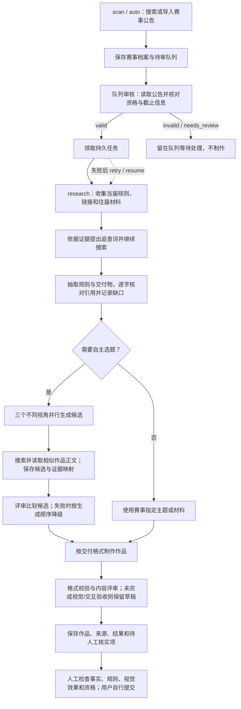

# Competition CLI

高校赛事发现、研究和作品制作 CLI。项目使用 TypeScript、LangGraph.js 和 SQLite，发现赛事后进入持久队列，逐个研究并按赛事交付要求制作；不自动报名或提交。

## 项目结构与工作流

### 主工作流



其中 `auto` 负责发现并入队，队列处理会先审核候选，只领取审核通过的赛事。研究阶段会从公告、附件和往届资料中整理证据，再按证据缺口继续搜索；可选研究运行时是否参与由 Agent 配置决定。选题阶段先由多个写作分支独立生成，再由评审 Agent 按规则适配、可行性、差异性和可验证性比较；评审模型不可用时才按生成顺序降级。PPT 预览只是渲染检查，不是自动视觉验收；网页作品会运行浏览器检查和关键操作用例，截图视觉质量及用例覆盖仍需人工终审。结果和缺口会保存下来，最终资格、事实和作品仍需人工核查。

`research <赛事ID>` 可单独运行研究图；`produce` 可按指定来源制作翻译或报告。这些手动任务不经过 `auto` 的自主选题与完整制作流程。

### 源码目录

```text
src/
├── cli.ts                 # 命令行入口：组装配置、数据库、模型网关和命令
├── ui.ts                  # 交互式终端界面
├── agents/                 # Agent 执行、模型/供应商路由、提示词、可选运行时
├── competition/            # 赛事发现、网页与证据、队列审核和队列处理
├── core/                   # 配置、SQLite 数据存储、模型网关和共享类型
├── workflows/              # LangGraph：自主制作，以及研究/翻译/报告流程
└── artifacts/              # PPT/文档/图片/网页生成、模板读取和预览

config/
└── config.example.json     # 配置样例；本地 config/config.json 不提交
deploy/
└── entrypoint.sh           # Docker 容器入口
test/                       # Node 内置测试，先构建 src 到 dist 后运行
data/                       # 运行时 SQLite、检查点、证据和任务产物（Git 忽略）
```

主要调用关系：`cli.ts` 进入 `competition/` 发现并审核赛事，`queue.ts` 领取任务后调用 `workflows/autonomous.ts`；自主流程复用 `workflows/workflow.ts` 中的研究图，再调用 `agents/` 访问模型和执行器、使用 `competition/sources.ts` 保存来源，最后由 `artifacts/` 生成和检查交付物。`core/store.ts` 保存赛事、队列和产物索引；LangGraph 检查点单独保存在数据目录。

| 文件/目录 | 职责 |
| --- | --- |
| `src/cli.ts`、`src/ui.ts` | CLI 命令注册和交互式终端操作 |
| `src/competition/discovery.ts`、`screening.ts`、`queue.ts` | 搜索赛事、筛选公告、审核队列、租约与失败重试 |
| `src/competition/sources.ts` | 获取网页和附件、提取内容、写入证据记录 |
| `src/workflows/autonomous.ts`、`workflow.ts` | 自主选题/制作图，以及研究、翻译、报告图 |
| `src/agents/agents.ts`、`models.ts`、`runtimes.ts`、`prompts.ts` | Agent 执行、模型配置、运行时管理和系统提示词 |
| `src/core/config.ts`、`gateway.ts`、`store.ts`、`types.ts` | 配置校验、模型与搜索调用、SQLite 数据层、共享数据结构 |
| `src/artifacts/` | 作品文件生成、官方模板填写、网页检查、PPT 预览 |
| `config/config.example.json` | 可复制后修改的配置样例 |
| `test/*.test.mjs` | 自动化测试；导入构建后的 `dist/` 模块 |

运行数据默认写入 `data/`：`competition.sqlite` 保存赛事、来源、队列和任务记录；`checkpoints.sqlite` 保存 LangGraph 检查点；`jobs/<任务ID>/` 保存研究报告、来源记录、缓存、运行时会话和作品文件。可通过 `COMPETE_DATA_DIR` 更改数据目录，通过配置字段 `dataDir` 设置存储位置。

## 架构和分工

- 七个 Agent 分别负责：写作（文档、译文、PPT、图片设计）、评审（规则提取、选题比较、作品验收、队列审核）、调度规划（把交付物拆成带验收标准的文件任务）、搜索结果评估、研究（多步追查往届名单和作品）、软件制作（按任务完整制作离线网页软件）、图片生成。每个 Agent 可单独选择供应商和模型；调度规划、搜索结果评估和研究未单独配置时沿用评审 Agent。
- 作品制作由中心调度完成：规划 Agent 输出结构化计划（任务、产物类型、格式、验收标准、打包方式），代码校验计划后按产物类型把任务分派给固定的执行 Agent（文档/PPT/翻译 → 写作，软件 → 软件制作，图片 → 图片生成）。评审不通过则带具体意见继续修改，单项默认最多制作与验收 4 轮，通过即结束；达到上限仍不通过则保留草稿。确实无法制作（视频、实物硬件等）才降级为 Markdown 制作方案。规划默认最多修正 3 轮，每轮接收上一份计划及校验反馈；仍无效或规划 Agent 不可用时按格式规则生成确定性计划。计划和每项结果保存在任务目录的 `plan.json`、`orchestration.json`、`deliverables.json`，恢复时核对输入和文件后复用已完成工作。
- 研究和软件制作 Agent 需要运行时，可选 Claude Code、Codex 或 OpenCode，按需下载。研究 Agent 返回的地址由程序重新获取后才能作为来源；附件、链接或单个候选模型失败会记录在任务目录并继续其他阶段，代码仍需进一步人工检查。
- Brave Search API 或用户配置的 SearXNG 提供赛事发现与研究搜索；LangGraph 和 SQLite 保存流程、证据与队列。

当前作品支持文本、DOCX、文字型 PDF、PPTX、PNG/JPG 和静态网页 HTML/ZIP。文字类赛事未公开交付格式时，可生成完整文档，但登记为 `draft`；评审不可用时也保留草稿。图片/PPT 尚未完成实际画面的视觉验收；软件已有浏览器实测，视觉质量与用例覆盖仍需人工终审，因此这些产物即使内容评审通过也保留为 `draft`。压缩包继承内部产物的未通过状态。真实材料、竞赛资格、AI 规则和最终作品仍须核实。

### 为什么需要这个项目，而不只是赛事提示词

项目定位是赛事领域的执行与验收系统，底层 Agent 是可替换的执行能力。七个角色多数是不同任务提示词和模型配置，并不等于七个独立自治系统；角色数量、LangGraph 和多供应商不是效果优势的证据。只做一场比赛时，通用 Agent 配合明确的提示词通常更轻便。

持续处理多场比赛时，程序应提供这些可检查的行为：

| 能力 | 程序承担的约束 | 当前边界 |
| --- | --- | --- |
| 持久执行 | SQLite 原子领取、租约、预算计数与检查点 | 成熟通用 Agent 也能提供；不是独有能力 |
| 证据记录 | 保存实际获取的网页，逐字核对来源引用 | 引用出现不代表来源权威，也不证明推论正确 |
| 交付约束 | 规划校验格式、数量、ZIP 归属；从实际文件检查大小、页数、尺寸、固定文件名和附件名 | 字数口径不清、个人信息占位、复杂数量与附件描述保留为待核实 |
| 验收状态 | `deliverables.json` 分别记录格式、内容、视觉或交互检查；模型的 `pass` 不能代替未执行的检查 | 内容评审仍是模型判断；`submission` 也需要人工终审 |
| 恢复完整性 | 跳过任务前比对输入指纹、产物路径和 SHA256；缺失或变化则重新制作/评审 | 上游研究检查点不会自动重新获取更新后的公告；不是外部事实的实时监控 |

规划和模型缓存按输入版本保存，产物按任务输入及制作轮次分目录，返工不会覆盖上一轮。`orchestration.json` 和 JSON 缓存采用同目录临时文件替换；`resume-checks.json` 记录每项是否复用及原因。旧任务没有收据时会重新执行制作验收；如果模型输入未变，可以从已缓存正文重建丢失的文件。打包读取已生成的作品归档，不重新读取可变的软件工作区。

每轮制作保存产物收据和评审结果。中途失败后，恢复会校验已保存的文件，复用完成的轮次；例如第三轮评审中断，不必重新执行前两轮。写作返工会带入上一版完整作品，软件返工会将上一轮普通文件复制到新工作区后修改。任务仍处于可恢复状态时，提高制作轮数后再次进入制作节点，原先达到上限且评审失败的草稿可继续后续轮次，仍受任务预算约束；已结束的整场任务不会因修改设置自动重开。

候选比较会读取实际获取的相似作品正文，`candidate-evidence.json` 保存候选编号、查询、来源正文片段、获取时间和失败记录。只有成功生成的候选参与编号和选择；评审选择越界时降级为首个候选并保留缺口。搜索无结果、失败或只有摘要均不能证明原创；比较得到的风险会传入规划并保留在最终结果中。

`requirements.json` 保存每项交付物的原始要求、测量值、通过/失败/未核实状态，以及能逐字核对的规则引用。明确数值限制失败时，单文件任务会带实测反馈在剩余制作轮数内返工；最终数量、命名和附件不符时保留为草稿。固定文件名可以自动应用，包含学校、姓名等占位要求不会编造身份。支持的限制示例为 `文件大小不超过1MB`、`页数：不超过10页`、`尺寸：1920×1080像素`、`含标点不含空白字符数：不少于1000字`；`1000字以内` 未明确口径，会保留待核实。字符数来自导出文件全文，包含标题和标点；Word 页数需渲染后才能核实。

当前尚未证明这套系统比“同一模型＋通用 Agent＋赛事提示词”质量更高。后续对照应固定赛事、来源、模型和预算，比较合格交付率、人工修改时间、失败恢复后的重复调用、漏件和违规率，再决定是否值得增加更多角色。浏览器验收已接入软件返工闭环；自动视觉验收、真实模型质量对照仍未完成。

### 离线交付对照

`evaluate` 使用同一份赛事档案检查多个执行器的实际文件，不调用模型或读取 API 密钥。先运行内置的检查器示例：

```powershell
node dist/cli.js evaluate evaluation/example.json
node dist/cli.js evaluate evaluation/example.json --output data/evaluation-example.json
```

示例只演示正常文件和缺件的区别，不是模型质量评测。真实对照可以复制 `evaluation/example.json`，为每个案例填写同一份 `brief`，把项目与通用 Agent 的输出分别加入 `runs`；文件路径相对于案例 JSON 所在目录，不能越出该目录。每个文件用 `deliverable` 关联交付物的零起始下标。可选 `usage` 记录 `model`、`budget`、`modelCalls`、`elapsedMs` 和 `manualReviewMinutes`，这些是填报值，检查器不验证其真实性。

结果仅使用 `mechanical_checks_passed`、`needs_review` 和 `failed` 表示可测量规则的状态，不把文件检查通过等同于内容真实、原创、视觉合格或功能可用。内容质量和真实人工修改时间仍需通过实际任务对照取得。

## 安装和配置

需要 Node.js 24，以及可访问相应服务的服务器和模型权限。模型 ID 只是示例，请按账户可用情况在 `config/config.json` 中配置。

```powershell
npm ci
npm run build
Copy-Item config/config.example.json config/config.json
npm start        # 在“Agent 设置”中选择供应商、填写密钥、下载运行时
node dist/cli.js doctor
```

只需要配置实际使用的供应商的密钥。`doctor` 检查环境变量和配置是否存在，不验证密钥、账户权限、模型、网络或额度。CLI 启动时会读取项目目录的 `.env`，该文件已被 Git 忽略；环境中已有变量优先。

### Agent 设置

交互界面的“Agent 设置”可以：

- Agent 配置：在“新增 Agent 配置、修改 Agent 配置、删除 Agent 配置”中管理七个内置角色；选择供应商时可直接选择“新增自定义供应商”，填写显示名称、接口协议、模型使用的 Base URL 和密钥环境变量名，也可以从“供应商”菜单单独管理。删除自定义配置后恢复默认，调度规划、搜索结果评估和研究 Agent 恢复为沿用评审 Agent。研究和软件制作 Agent 还要选择运行时，列表只显示与该供应商协议兼容的运行时，并标注是否已下载。
- 供应商：内置 Google Gemini、Anthropic Claude、DeepSeek、OpenAI，可添加自定义供应商并设置协议、Base URL 和密钥环境变量名。在界面输入的密钥只写入项目 `.env`，不写入配置文件。
- 运行时下载：Claude Code、Codex、OpenCode 不随 `npm ci` 安装。程序会先检测本机已安装的 CLI（npm 全局包或 PATH）：已安装 Claude Code 或 Codex 时只需下载 SDK（约 55 MB / 1 MB），并使用本机版本；否则下载完整版到 `runtimes/` 目录（约 290 / 470 / 400 MB，可用 `COMPETE_RUNTIME_DIR` 修改）。OpenCode 已安装在本机时无需下载。状态显示为“已下载”“使用本机”“本机已装，缺 SDK”或“未下载”。设置 `COMPETE_SYSTEM_RUNTIMES=0` 可不使用本机版本。
- 系统提示词：见下文。

| 协议 | 说明 | 可用运行时 |
| --- | --- | --- |
| Gemini API | Google Gemini | OpenCode |
| Anthropic Messages | Claude；DeepSeek 等兼容服务需填 Base URL | Claude Code、OpenCode |
| OpenAI 兼容（Chat Completions） | OpenAI 及各类兼容服务 | Codex（需支持 Responses API）、OpenCode |

图片生成目前只支持 Gemini 协议。Claude Code 连接非官方地址时，研究 Agent 只开放 WebFetch，因为 WebSearch 是 Anthropic 服务端工具。运行时只获得当前 Agent 的密钥，主目录与用户全局配置隔离；编码 Agent 只能写入工作区，不能执行 shell。

命令行也可以查看和管理：

```powershell
node dist/cli.js agents                     # 各 Agent 的供应商、模型、运行时和状态
node dist/cli.js runtimes                   # 运行时状态，含本机版本和路径
node dist/cli.js runtime-install claude-code  # 本机已装时只下载 SDK；加 --full 下载完整版
node dist/cli.js runtime-install opencode
node dist/cli.js runtime-remove opencode
```

Docker 镜像默认不含运行时，构建时可用 `--build-arg AGENT_RUNTIMES="claude-code opencode"` 预先下载。旧版配置中的 `writer`、`reviewer`、`image`、`coder`、`researchAgent` 字段仍可读取，在界面保存 Agent 设置后会转换为 `providers` 和 `agents`。

搜索默认需要 Brave Search API；也可把配置里的 `search` 改成：

```json
{"provider":"searxng","url":"http://127.0.0.1:8080"}
```

SearXNG 服务须启用 JSON 输出（`settings.yml` 的 `search.formats` 加入 `json`）。可在 `sources` 中配置赛事列表页；系统同时搜索并读取这些页面。

赛事发现的可选参数（均有默认值）：`pages` 每个搜索词翻几页（默认 2），`timeRange` 时间范围 `any/day/week/month/year`（默认 `year`，只用于发现，研究往届资料不限时间），`language`（默认 `zh-CN`，仅 SearXNG），`perHost` 每个网站每次最多新增几场（默认 4），`queriesPerRun` 每次使用几个搜索词（默认 8），`queries` 自定义搜索词。自定义搜索词每次都会使用，剩余名额从 20 个内置方向中按最久未搜索轮换。不同学校转发的同一届赛事（按“第 X 届……大赛”识别）只收录一条。`screen`（默认开启）在入队前让“搜索结果评估” Agent 用评审模型按每 20 条一批初筛标题和摘要，只剔除明显不是当届赛事公告的结果（百科、汇总页、获奖公示、新闻报道、广告等），拿不准的保留给队列审核；剔除理由记录在发现记录中，已剔除的链接以后不再评估。评估失败时全部保留，不会阻断发现。以上设置、测试搜索和最近发现记录都可以在交互界面的“搜索设置”中查看和修改。使用 `scan --url` 导入公告不需要搜索密钥。旧配置中的 OpenCode 地址、密码和 `searchProvider` 不再生效，请参考新示例配置迁移。

也可设置 `"search":{"provider":"sources"}`，只监测 `sources` 中配置的高校通知列表，不需要搜索密钥。此模式不是全网搜索，不支持 `--query`，不能追查不在这些页面及公告链接中的往届作品；研究结果会记录检索范围受限。各校公告可能仅限本校参赛，也可能已经过期，入队前后仍须核验。

研究 Agent 默认启用，可在 `agents.research` 设置供应商、模型、运行时、`enabled`、`maxTurns`、`maxBudgetUsd` 和 `timeoutSeconds`。未显式配置旧版 `researchAgent` 时，研究默认使用独立的 Gemini 研究模型；配置了旧版字段时仍兼容沿用评审模型。研究、网络请求和编码运行时都有有限重试，长任务通过 LangGraph 检查点和 Agent 会话文件恢复；失败来源会记录在 `source_attempts`，不会因为单个附件失败而丢弃整场赛事。禁用研究运行时后仍保留搜索、后续查询、规则提取和证据核验。Agent 搜索能力受账号权限、地区与网络影响。供应商的 Base URL 会接收对应密钥，只能指向可信服务。

### 长任务设置

交互界面的“长任务设置”可调整以下项目，也可直接编辑配置；`node dist/cli.js execution` 显示当前有效设置。

| 配置字段 | 默认值 | 含义 |
| --- | --- | --- |
| `execution.productionRounds` | 4 | 每项交付物的制作与验收轮数上限，范围 1–8 |
| `execution.plannerRounds` | 3 | 交付计划的生成与修正轮数上限，范围 1–5 |
| `execution.researchRounds` | 3 | 依据已有证据继续提出查询的轮数上限，范围 1–6 |
| `execution.requestTimeoutSeconds` | 300 | 普通模型和图片请求每次尝试的超时秒数，范围 30–1800 |
| `maxCalls` | 80 | 新任务默认预算单位；命令行 `--budget` 可覆盖 |

轮数是上限，不会强制用满：制作通过、没有新的追查词或遇到无法继续的条件时提前结束。规划和制作轮数用于完整自主制作流程，不改变手动 `produce` 的翻译与报告流程。已写入配置的旧值会保留，不会仅因升级自动提高。

研究和软件制作运行时的限制在“Agent 设置 → 修改 Agent 配置”中调整：`timeoutSeconds` 默认 1200 秒，范围 30–3600；`maxTurns` 默认分别为 8 和 20，范围 1–100。Claude Code 使用 `maxTurns` 和 `maxBudgetUsd`（默认 1 美元）；OpenCode 将 `maxTurns` 传为执行步骤 `steps`；Codex 没有在此接入内部轮数限制，由项目预算预留和执行超时约束。运行时的有限重试共享同一个截止时间，每次重试重新预留预算，不重置完整执行时长。

## 使用

在交互终端中直接运行 `npm start` 或 `node dist/cli.js ui`，可用方向键搜索或导入赛事；进入“查看队列”后选择赛事即可查看、修改或移除，再进行审核与逐个处理。队列较大时界面按当前终端一屏分页（最多 30 条），队列页支持 `n` 下一页、`p` 上一页、`j` 输入页码跳转、`s` 筛选、`i` 选择当前页赛事、`q` 返回，避免一次重绘全部记录。终端界面使用开源的 `@clack/prompts` 和 `cli-table3`；原有命令仍适用于脚本和服务器。

“任务进度与验收”可选择最近任务或输入任务 ID，查看当前动作、轮次、预算、每轮产物和返工意见，以及作品验收、规则实测、选题证据、恢复记录与文件路径；赛事详情也可进入同一页面。任务详情还可暂停、继续、停止或调整总预算，并查看每轮浏览器报告和截图路径。“运行日志显示”默认只显示简洁进度，可在本次界面会话中开启原始模型返回。队列命令需要诊断原始返回时可设置 `$env:COMPETE_VERBOSE='1'`。

执行中每 15 秒更新一次模型调用进度；任务目录的 `runtime-progress.json` 保存最近事件，`progress.jsonl` 追加历史事件。事件只保存阶段、动作、轮次、耗时和预算等摘要，不写入完整提示词或凭据。`status <任务ID>` 返回任务记录及这些验收视图；进度事件是上次记录，进程中断后不会继续刷新，不能据此断言进程仍存活。

```powershell
# 发现赛事并入队
node dist/cli.js scan --query '大学生 设计大赛 作品征集'
node dist/cli.js scan --url 'https://主办方公告地址'
node dist/cli.js queue
node dist/cli.js queue-review --limit 10
node dist/cli.js queue-history <赛事ID>
node dist/cli.js queue-add 'https://主办方公告地址'
node dist/cli.js queue-edit <赛事ID> --title '修改后的名称'
node dist/cli.js queue-delete <赛事ID>
node dist/cli.js queue-decision <赛事ID> valid --reason '已人工确认当届要求'

# 根据队列逐场处理
node dist/cli.js work --limit 3
node dist/cli.js status <任务ID>
node dist/cli.js execution
node dist/cli.js retry <赛事ID>
node dist/cli.js enqueue --all

# 自动发现、入队、处理
node dist/cli.js auto --limit 3
node dist/cli.js auto --url 'https://主办方公告地址' --budget 120
```

### 网页作品的实际验收

软件导出后，程序直接读取最终 HTML/ZIP，在隔离的 Chromium 上下文中检查桌面和手机视口、JavaScript/控制台错误、缺失资源与横向溢出，并保存截图。页面只可访问该交付物的本地临时服务；外部连接、WebSocket、服务工作线程、下载和新窗口不作为通过路径。ZIP 路径、数量和解压体积受限；浏览器保持沙箱，不读取用户浏览器会话。

评审模型依据任务要求和实际文件提出有限的声明式用例，程序只解释 CSS 选择器上的点击、输入、选择和勾选，以及文字、值和可见性断言，不执行模型提供的脚本。首轮用例在后续返工中复用。实测失败进入下一轮制作反馈；每轮的报告、文件 SHA256、操作结果和截图保存在该轮的 browser/ 目录，并显示在“浏览器验收与截图”。验收总时长最多 90 秒，不包括浏览器启动（最多 15 秒）。

浏览器缺失或无法启动、没有有效用例、标准未被用例覆盖时记为未核实。截图仅是检查材料；模型设计的用例可能遗漏缺陷，通过用例也不能证明全部功能、视觉质量和竞赛适用性，因此软件仍保留为草稿等待人工终审。

浏览器依赖使用 Playwright，Chromium 单独安装；Windows 也可使用检测到的 Edge/Chrome。可通过 COMPETE_BROWSER_EXECUTABLE 指定可执行文件。首次使用：

~~~powershell
npx playwright install chromium
node dist/cli.js browser-status
node dist/cli.js browser-check evaluation/browser-example/index.html --suite evaluation/browser-example/suite.json --output data/browser-example
~~~

browser-check 不调用模型，不需要 API 密钥。不传 --suite 只做页面检查，不会标记完整交互验收通过。该示例用于验证验收器，不是参赛质量评测。

### 暂停、继续和停止

任务详情提供控制菜单。交互界面处理队列时，按 P 或 Ctrl+C 请求暂停，按 S 请求停止；程序让当前调用完成并保存成果，再在安全边界结束本批处理。等待期间仍可能产生当前调用的费用，也可能要等待该调用的超时上限。可在另一终端控制正在运行的任务：

~~~powershell
node dist/cli.js pause <任务ID>
node dist/cli.js status <任务ID>
node dist/cli.js budget <任务ID> 120
node dist/cli.js resume <任务ID>
node dist/cli.js work --limit 1
node dist/cli.js stop <任务ID>
~~~

暂停请求和停止请求持久化，status 返回 control，界面区分等待生效与已暂停。resume 对队列任务只重新排队，继续由 work 领取并核对赛事审核；独立任务直接从检查点继续。总预算不能低于已消耗量，也不清零已用量。已停止任务保留文件，普通 retry 不会再领取；需要重新制作时用 enqueue <赛事ID> --redo 创建新任务。已完成任务不能暂停或继续。

独立任务与队列任务都有执行租约，防止两个进程同时恢复同一检查点；进程异常退出后需等待租约过期。暂停不是强行杀死进程，已经发出的外部请求无法撤回。

### Agent 系统提示词

七个 Agent 都有内置系统提示词：`writer` 写作、`reviewer` 评审与审核、`planner` 调度规划（使用评审模型）、`screener` 搜索结果评估（使用评审模型）、`research` 研究 Agent、`coder` 软件制作、`image` 图片生成。在交互界面选择“Agent 设置 → 系统提示词”可以查看、在编辑器中修改或恢复默认；编辑器默认使用 `EDITOR` 环境变量，Windows 上未设置时用记事本。也可以用命令：

```powershell
node dist/cli.js prompts            # 查看全部
node dist/cli.js prompt-set writer --file my-writer.txt
node dist/cli.js prompt-reset writer
```

修改保存在配置文件的 `prompts` 字段，下次调用对应 Agent 时生效。提示词通过各协议或运行时的系统提示词通道传入；Codex 和图片模型没有该通道，提示词加在任务内容前面。各任务提示词里的防注入、禁止编造约束和输出格式要求是固定的，不受这里的修改影响。

内置提示词要求各角色读取实际提供的上下文，保留已正确内容，处理具体反馈并交付本轮完整结果；只报告实际获取的来源和执行过的检查。写作、规划、研究和软件角色各有续作规则，评审应核实修订且避免反复更换标准，初筛完成当前批次即停止，图片角色每次只负责本轮生成。达到目标或轮数、时间、预算边界时记录剩余缺口，输出仍须符合原有 JSON 协议。持续工作由这些提示词配合程序传递上下文、保存检查点和控制执行边界完成。已有自定义提示词不会被新默认值覆盖；需要使用新版默认值时，选择“恢复默认”或执行 `prompt-reset`。

`research <赛事ID>` 可单独研究，`show <赛事ID>` 查看档案与来源。手动 `produce` 支持翻译和报告，使用 `node dist/cli.js produce --help` 查看参数；不属于队列的失败任务可用 `resume <任务ID> --budget 40` 恢复。

队列存储在 `data/competition.sqlite`，每场任务的检查点和产物在数据目录中。`queued` 表示等待、`processing` 表示处理中、`completed` 表示流程结束、`failed` 表示执行中断，`paused` 表示已暂停，`stopped` 表示已停止；完成不代表作品符合全部要求。单场任务或审核失败会记录错误并继续处理同一批其他赛事；失败后 `retry` 再运行 `work`，继续原任务。进程被强制终止后，队列租约最长约 5 分钟过期，再运行 `work` 可恢复。不要同时让多个容器使用不支持 SQLite 锁语义的网络共享目录。

审核状态独立于处理状态：`unreviewed` 未审核、`valid` 通过、`invalid` 无效、`needs_review` 待人工确认。审核器读取公告和相关链接，由评审模型判断是否仍能报名或提交，并核对原文引用；缺少证据、截止时间不明或来源无法读取时标为待确认。自动审核每场最多调用一次评审模型，`--limit` 限制数量；`work` 在制作前会先审核不超过 `--limit` 场，只有审核通过的项目会被领取。结果可能出错，资格和截止时间仍需人工核对；可在界面人工修改审核结果。已确认的截止日期过期后不会继续进入制作。审核记录保存在数据库，删除队列项不会删除赛事档案、审核历史或已有任务产物。公告地址已有来源或任务后不能修改，以免混淆证据；请另加新赛事。

LangGraph 检查点和 Agent 会话 ID 分别保存。Claude 研究会话、事件保存在任务目录 `claude-research/`；Codex 工作区和线程位于该交付物的 `workspace/`，因此恢复依赖保留整个数据目录。Agent 输出和网页均为外部信息，来源可访问并不证明其内容真实。

`--budget` 是项目侧预算单位：普通模型或图片调用预留 1，研究运行时每次执行预留 `maxTurns`，Claude Code 编码执行预留 `maxTurns`，Codex / OpenCode 编码执行预留 8。运行时重试会再次预留；普通模型调用中的有限网络重试不逐次计数。因此它不是严格的 API 请求总数或美元上限，也不表示实际已花费金额。Claude Code 另受运行时的 `maxTurns` 和 `maxBudgetUsd` 限制。

保存“长任务设置”不会直接改写已有任务预算。恢复队列任务时，`retry` 后执行 `work --budget 120` 可把总上限提高到 120，已消耗量不会清零；省略 `--budget` 会使用配置值，若高于旧上限也会提高该任务上限。独立任务可用 `resume <任务ID> --budget 120` 调整总上限后恢复。

## Linux 部署

```sh
docker build -t competition-cli .
docker run --rm -v "$PWD/data:/data" \
  -e GEMINI_API_KEY -e ANTHROPIC_API_KEY -e OPENAI_API_KEY -e BRAVE_SEARCH_API_KEY \
  competition-cli auto --limit 3 --budget 40
```

使用自定义配置时挂载配置并传 `--config`。容器包含 LibreOffice、Poppler 和中文字体用于 PPT 预览；浏览器验收需要另外安装 Chromium 及系统依赖（npx playwright install --with-deps chromium），并在支持 Chromium 沙箱的非 root 用户环境运行，无法启动时保留未核实状态，不关闭沙箱；PDF 中文输出还需要通过 `COMPETE_PDF_FONT` 指定可嵌入的中文 TTF 字体。代码 Agent 使用 Codex 的 workspace-write 沙箱并关闭网络，运行依赖宿主机支持相应沙箱；部署时应验证容器权限和隔离配置，不应自动回退到完全开放的权限。将工作目录和凭据按最小权限隔离。可用 cron 或 systemd 定期运行 `auto` 和 `work`。

## 测试

```sh
npm test
```

测试使用模拟模型和搜索服务，不消耗 API 额度。浏览器测试在已安装 Chromium 时运行真实页面和交互，否则显示跳过；可用下方示例独立验证浏览器环境。真实模型服务、Claude Code / Codex / OpenCode 长任务、搜索服务及 Linux 沙箱仍需配置有效凭据和运行环境后联调。
